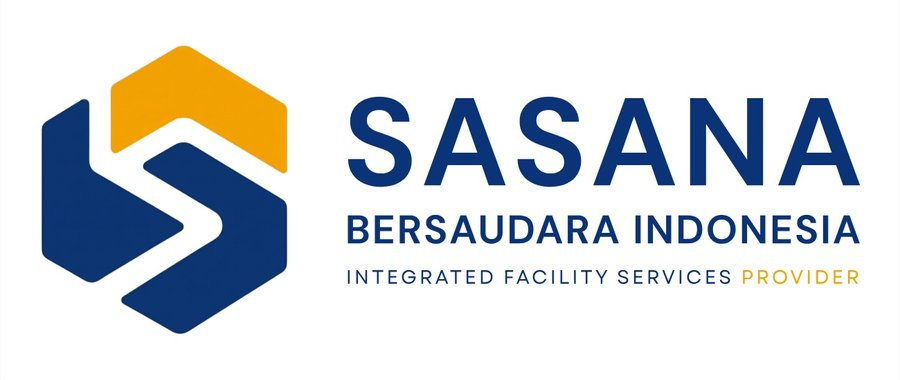

  

# PT. Sasana Bersaudara Indonesia

**Integrated Facility Services Provider** — berdiri sejak 2013, berpusat di Kabupaten Trenggalek, Jawa Timur, Indonesia.

🌐 **Website resmi:** https://sasanabersaudara.biz.id/

---

## Tentang Kami

PT. Sasana Bersaudara Indonesia (SBI) adalah perusahaan penyedia layanan fasilitas terpadu (*integrated facility services*) yang mendukung operasional institusi dan perusahaan melalui pengelolaan sumber daya manusia dan layanan pendukung yang profesional, terukur, dan berkelanjutan.

Sejak 2013, SBI dipercaya oleh berbagai rumah sakit, instansi pemerintah, dan institusi pendidikan di Jawa Timur untuk menghadirkan lingkungan kerja yang bersih, aman, dan nyaman — dengan **36 proyek yang telah diselesaikan pada 2017–2026**.

> *SBI — Integrated Service. Professional People. Reliable Solutions.*

## Layanan Kami

- **Human Capital Management** — pengelolaan dan pengembangan SDM operasional
- **Cleaning Service** — layanan kebersihan gedung dan area publik
- **Pertamanan & Lanskap** — perawatan taman dan ruang terbuka hijau
- **Security Service** — layanan pengamanan dan pengawasan
- **Logistics & Warehouse Support** — dukungan logistik dan pergudangan
- **Technical Services** — layanan teknis dan pemeliharaan fasilitas
- **Administrasi & Dukungan SDM** — dukungan administrasi dan kepegawaian
- **General Support Service** — layanan pendukung umum operasional
- **Home Cleaning** — layanan kebersihan untuk hunian

## Nilai Perusahaan — PRIMA

| Huruf | Nilai | Makna |
|---|---|---|
| **P** | Professionalism | *Professional in Every Action* |
| **R** | Reliability | *Reliable in Every Commitment* |
| **I** | Integrity | *Honest in Every Relationship* |
| **M** | Mutual Growth | *Growing Together, Creating Value* |
| **A** | Adaptive Excellence | *Adapt, Improve, Excel* |

## Dipercaya Oleh

RSUD dr. Soedomo Trenggalek · Setda Kabupaten Trenggalek · Dinas Kesehatan Kota Blitar · DKPP Kota Blitar · RS Budi Asih Trenggalek · RSUD Mardi Waluyo Blitar · RSIA Harapan Sehat dan Tentram · Poltekpel Surabaya · Klinik Wijaya Kusuma Medika · MI Walisongo · dan institusi lainnya.

Daftar lengkap proyek dapat dilihat di [website kami](https://sasanabersaudara.biz.id/#proyek).

## Kontak

- **Lokasi:** Kabupaten Trenggalek, Jawa Timur, Indonesia
- **Email:** sasanabersaudara@gmail.com
- **Telepon/WA:** 0895404950080
- **Website:** https://sasanabersaudara.biz.id/

---

Repositori ini berisi kode sumber website resmi PT. Sasana Bersaudara Indonesia, diterbitkan melalui GitHub Pages. Situs dibangun sebagai halaman statis (HTML, CSS, dan JavaScript murni) dengan dukungan SEO dan PWA.
